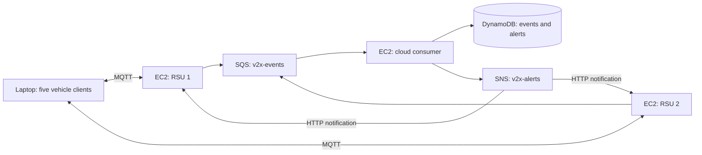
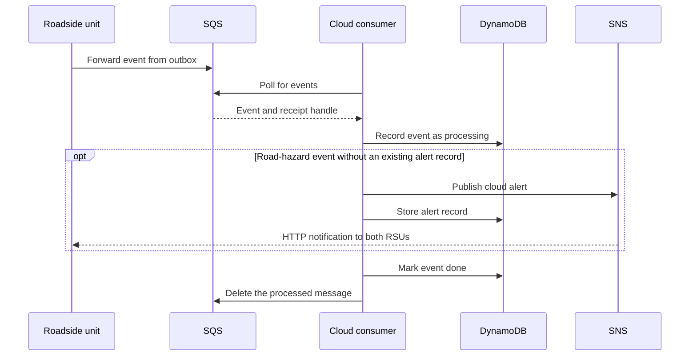
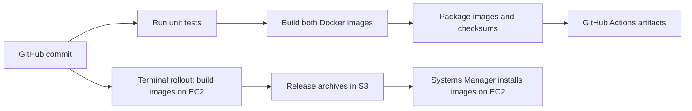

# V2X project guide

This project simulates five cars that report traffic events and receive warnings. You run the cars on your laptop. In AWS, two roadside units handle the cars and a third machine processes events in the cloud. Start with the [demo steps](#run-the-demo), or follow the architecture below to see what happens to each message.

## How the system fits together



An **RSU** is a roadside unit. Each one runs a Mosquitto broker, which routes messages to subscribers by topic, and a Python application, which decides what to do with each event. MQTT is the protocol the vehicles use to communicate with their broker. Three vehicles use RSU 1 and two use RSU 2. The alert arrows back to the laptop include both locally generated warnings and warnings returned by AWS.

| Component | Where it runs | Source and purpose |
| --- | --- | --- |
| Vehicle simulator | Laptop | [coches.py](local_files/coches.py) generates and publishes events and prints received alerts |
| MQTT broker | Inside each RSU container | [mosquitto.conf](rsu/mosquitto.conf) listens on TCP 1883 |
| RSU application | Two separate EC2 hosts | [rsu.py](rsu/rsu.py) filters messages, stores an outbox, and relays alerts |
| Event queue | AWS SQS | `v2x-events` holds messages until the consumer can process them |
| Cloud consumer | Third EC2 host | [adminalertas.py](adminalertas.py) reads SQS, stores data, and sends hazard alerts |
| Persistence | AWS DynamoDB | `v2x-events` stores events by ID and `v2x-alerts` stores cloud alert records by ID |
| Alert distribution | AWS SNS | `v2x-alerts` sends a copy of each cloud alert to each subscribed RSU |
| Images and rollout | GitHub, S3, Systems Manager, and EC2 | The two [consumer](Dockerfile) and [RSU](rsu/Dockerfile) builds package code. S3 holds archives, and Systems Manager runs Docker commands on the hosts |

## 1. What the vehicles send

Each vehicle is a separate MQTT client inside one Python process. Each event includes a UUID, a vehicle ID, an RSU ID, a timestamp, an event type, a location, and a payload. The simulator cycles through routine traffic (`rutina`), hard braking (`frenado brusco`), and road hazards (`peligro_carretera`). Position, speed, and density are synthetic payload fields. The current alert rules use the event type.

```python
result = client.publish(f"v2x/{rsu}/events", json.dumps(event), qos=1)
result.wait_for_publish(timeout=5)
if not result.is_published():
    raise RuntimeError("MQTT acknowledgement timed out")
```

`json.dumps` turns the Python dictionary into message text. At QoS 1 the publisher waits for the broker to acknowledge the send. The simulator's `sent` log line means that acknowledgement arrived. The RSU and cloud each have their own processing and persistence steps. QoS 1 can deliver repeated messages, which is why event IDs matter.

| Vehicles | Publish events to | Subscribe for alerts on |
| --- | --- | --- |
| `veh-1` to `veh-3` | `v2x/rsu-1/events` | `v2x/rsu-1/alerts` |
| `veh-4` and `veh-5` | `v2x/rsu-2/events` | `v2x/rsu-2/alerts` |

The MQTT network loop runs in the background. When it receives an alert, its callback prints the payload. The same alert ID can therefore appear several times, once for each receiving client. The ordinary simulator output does not include the receiving vehicle ID.

## 2. What each roadside unit does

Mosquitto runs inside both RSU containers. Its broker configuration is:

```conf
listener 1883
allow_anonymous true
```

Docker exposes the listener through the EC2 host with `-p 1883:1883`. The laptop connects to each host's public IP. Inside the same container, the RSU Python application connects to `127.0.0.1` and subscribes to its own event topic. AWS security groups restrict MQTT ingress to the simulator's public IPv4 address. The broker currently uses plaintext MQTT and no broker login.

The RSU checks the required fields, the event type, and the RSU ID. Each vehicle's routine events are forwarded at most once every five seconds. Braking and road hazards bypass this routine sampling. Hard braking generates a local alert immediately, even while the RSU cannot reach SQS. The RSU publishes the alert to its broker with a stable `local-<event_id>` ID.

```python
now = time.monotonic()
if kind == "rutina" and now - last_routine.get(source, -10) < 5:
    return
```

Selected events go into a SQLite **outbox**, a small database of events waiting to be sent. A Docker volume mounted at `/state` preserves the file across container replacement. The worker takes the oldest row, calls SQS, and deletes that row after SQS accepts it. Failed sends stay queued and are retried. The backlog is capped at 10,000 rows. A repeat ID already in the outbox can be discarded there. A copy arriving after the preceding row was sent can still reach SQS.

Cloud alerts return through HTTP on port 8080 at `/sns`. A new SNS subscription first sends a confirmation request. The RSU verifies the expected SNS topic and signature before confirming it. For a normal notification the handler unwraps the alert, checks the alert ID against its local delivered table, and publishes it to the MQTT alerts topic.

## 3. What happens in AWS



The consumer polls for up to ten messages per request. It records each event under its unique ID. A conditional write detects an already completed event and logs a duplicate. A failed attempt can retry a record still marked `processing`. A road hazard produces a cloud alert with the ID `cloud-<event_id>`. SNS delivery happens asynchronously. The alert row confirms the consumer recorded publication, and the simulator proves delivery back to a vehicle.

```python
process(json.loads(message["Body"]), db.Table("v2x-events"),
        db.Table("v2x-alerts"), sns, topic, meta)
sqs.delete_message(QueueUrl=queue, ReceiptHandle=message["ReceiptHandle"])
```

If `process` raises, deletion is skipped and SQS can deliver the message again. There is also a small failure window if SNS accepts a publish before DynamoDB records it. The stable alert ID helps the RSUs suppress a repeated cloud notification.

| AWS setting | Project configuration and reason |
| --- | --- |
| Region | Antonio's lab uses `us-east-1`. Select it in the AWS console so you see the same resources. |
| EC2 instances | `v2x-rsu-1`, `v2x-rsu-2`, and `v2x-service` separate the two brokers and the consumer. |
| Instance permissions | `LabInstanceProfile` allows the containers to call AWS APIs without storing credentials in the code. The observed instance metadata hop limit was 2 for Docker networking. |
| Network | RSUs accept MQTT TCP 1883 from the simulator's public IP and SNS HTTP on TCP 8080. The RSU verifies SNS signatures. The consumer does not expose a public project port. |
| Queue | Standard `v2x-events`, with 20-second long polls to reduce empty requests and a 60-second visibility timeout to give the consumer time to finish. |
| Dead-letter queue | `v2x-events-dlq` receives messages that repeatedly fail. The configured receive limit is five. |
| Topic | Standard SNS `v2x-alerts` with two confirmed HTTP subscriptions, one per current RSU address. |
| Tables | `v2x-events` uses `event_id` as its key. `v2x-alerts` uses `alert_id`. Both store the message body as JSON text. |
| S3 releases | `v2x-artifacts-364733575524-us-east-1` holds the versioned image archives and checksums. A folder under `releases/` is a Git commit ID, which identifies the source used for that release. |

## 4. GitHub Actions and deployment

**Yes, GitHub Actions runs real tests.** The `ci` job installs the dependencies, executes `python -m unittest discover -s tests`, builds both Docker images, and uploads the packages as run artifacts on a push. The ten tests cover consumer processing, retries, handling completed events, and experiment metrics. In the verified run on commit `4774932`, the CI job succeeded and the AWS deployment job was skipped. [GitHub Actions run](https://github.com/migui4311/primeraentregaMigAnt/actions/runs/43612097317)

The workflow runs CI on pushes to `antonio/v2x-final` and on pull requests targeting `main`. It still has a deployment condition tied to the old `development_antonio` branch. Pushes to the final branch run CI and skip that deploy job. The verified AWS rollout was performed separately through the terminal. The older [main workflow](.github/workflows/deploy.yml) does a source upload and uses a simple file-exists check.



Docker images package the app and its dependencies. A **container** is a running copy of an image. Both RSUs use the same image, with different `RSU_ID` settings and separate local Docker volumes. Each deployment checks the downloaded archive with its SHA-256 checksum and runs a startup check on the container.

[scripts/aws_deployment.py](scripts/aws_deployment.py) deploys images to existing resources and can refresh SNS subscriptions. It has no provisioning command. The live rollout reused Antonio's existing infrastructure. I built its images on EC2 from `35513a6`, which has the same runtime source files as `4774932`. The latter changed delivery tooling and documentation. The GitHub job that publishes and installs its own artifacts on AWS remains unverified.

To reinstall an already published release, first check your lab identity. Then pass the release's full commit SHA and the three instance IDs in service, RSU 1, RSU 2 order. This changes the running containers. The normal demo below only requires them to be up.

```powershell
aws sts get-caller-identity --profile antonio --query Account --output text
python scripts/aws_deployment.py --profile antonio deploy --bucket v2x-artifacts-364733575524-us-east-1 --revision 35513a61e6785044568ac908f0b91e047135f228 --instances i-0bd3200bb0d5d4be1 i-022b7542b0fc7387a i-0d2d5a979f66f85c2 --topic arn:aws:sns:us-east-1:364733575524:v2x-alerts --queue https://sqs.us-east-1.amazonaws.com/364733575524/v2x-events
```

The identity check should show account `364733575524`. The command assumes your `antonio` AWS CLI profile has fresh lab credentials, including the session token, and the release archives are still in the bucket. A simulator run only needs the two current RSU addresses. It does not use the AWS profile.

## Run the demo

### A. Check AWS before presenting

1. Start your **AWS Academy Learner Lab**, open its AWS Console, and select **US East (N. Virginia)**. Open **EC2 → Instances**. The three V2X instances should be **Running** and have passed their status checks.
2. Copy the current **Public IPv4 address** for `v2x-rsu-1` and then `v2x-rsu-2`. Use that order in the simulator. Avoid relying on addresses from an older lab session.
3. Open **SNS → Topics → v2x-alerts → Subscriptions**. Look for two **Confirmed** subscriptions whose URLs are `http://<CURRENT_RSU_IP>:8080/sns`. If an address changed, create a subscription for the new address, wait for confirmation, then remove the old endpoint that belonged to that RSU.
4. If the laptop has changed networks, open each RSU's **Security → Security groups → Inbound rules** and check that TCP 1883 allows its current public IPv4 with a `/32` mask.

### B. Open the cloud logs

In **EC2 → Instances**, select **v2x-service → Connect → Session Manager → Connect**. This opens a shell on the AWS virtual machine. Check Docker and follow the consumer logs:

```bash
sudo docker ps --filter name=v2x-service
sudo docker logs --tail 10 -f v2x-service
```

On either RSU, use `sudo docker ps --filter name=v2x-rsu` and `sudo docker logs --tail 10 -f v2x-rsu` instead. Open the two RSUs through their own EC2 sessions. Use **Ctrl+C** to stop following a log. That leaves the container running.

### C. Send five vehicle events

From the repository folder on your laptop, in PowerShell:

```powershell
python -m pip install -r requirements.txt
python local_files/coches.py --rsu RSU1_PUBLIC_IP RSU2_PUBLIC_IP --rounds 1 --rate 5
```

Replace both placeholders with the current IPs. One round sends five unique events and waits five seconds for alerts before exiting. Keep the AWS console log visible during the run.

| What you see | What that confirms |
| --- | --- |
| Five `"outcome": "sent"` lines | Both MQTT brokers accepted traffic from the five vehicle clients. |
| Local alerts with `"origin": "rsu-1"` or `"rsu-2"` | The RSU detected hard braking and notified its local vehicles. |
| `"origin": "cloud"` | A cloud hazard alert passed through SNS and an RSU back to MQTT. |
| `"outcome": "processed"` in the consumer log | The consumer completed processing for that event ID. |

### D. Verify persistence and explain the round trip

Copy an `event_id` from a laptop `sent` line. In **DynamoDB → Explore items → v2x-events**, look it up by the partition key `event_id` and check that `status` is `done`. For a `peligro_carretera` event, look up `cloud-<event_id>` in the `v2x-alerts` table and match it with an alert on the laptop. That sequence demonstrates broker acceptance, processing, persistence, and alert delivery.

If MQTT does not connect, check the public IP, container state, and the port 1883 inbound rule. If local alerts work but cloud alerts are absent, check the consumer logs, then SNS subscription status and port 8080. If the queue depth is rising, check whether the consumer is running. Some routine messages are intentionally filtered before they reach AWS.

## Experiment evidence and assignment progress

These are measurements from the Antonio live environment on 14 November 2026, with the application from `35513a6`. The raw JSON logs are kept alongside the workspace rather than committed to this repository.

| Check | Evidence |
| --- | --- |
| Live smoke test | Five events marked `done`, braking alerts from both RSUs, and five receipts for one cloud hazard. |
| Duplication experiment | At zero injected duplication, 40 sends. At a 20% duplication setting, 49 sends. Both runs had 40 unique events, 35 processed events, all 13 hazard records, and 65 cloud alert receipts. Hazard processing p95 was 475 ms and 343 ms, respectively. The small comparison does not establish a causal latency effect. |
| Consumer failure experiment | The cloud consumer stopped for 60 seconds. SQS reported a peak of 81 visible messages. Following restart, all 100 unique events reached `done` and all 33 hazard alert records were present. SQS depths are approximate. |
| RSU buffering | SQLite outbox and retry behavior are implemented. A deliberate live RSU-to-SQS disconnection check remains open. |
| Automated AWS rollout | CI verified and terminal rollout verified. GitHub-to-AWS deployment has not run successfully on this candidate. |
| Submission | This guide covers the final architecture and demo. The final assignment report can cite the measured results and identify the outstanding checks. |

[scripts/metrics.py](scripts/metrics.py) samples queue depth and turns simulator and consumer logs into experiment counts and latency summaries. A processing latency measures from the laptop's event timestamp to the consumer's processing timestamp. It depends on both clocks and excludes the SNS/MQTT return trip.
