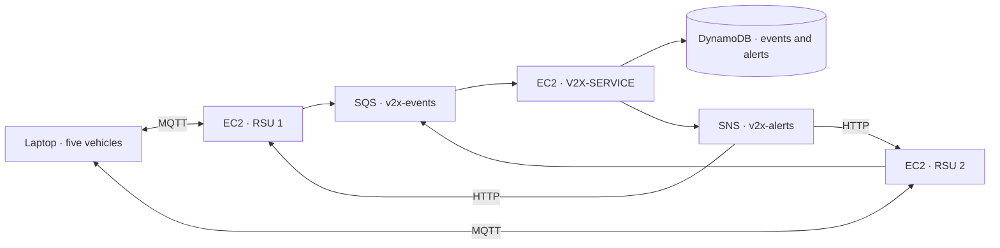

# V2X Monitoring and Alerting

Five simulated vehicles send traffic events to two roadside units (RSUs) over MQTT. Each RSU warns its own vehicles about hard braking and forwards selected events to AWS. The cloud consumer stores events in DynamoDB and sends road-hazard alerts back to both RSUs through SNS. The simulator prints the alerts it receives over MQTT.

## Run the tests locally

Use Python 3.12, the version used by the Docker images. From the repository root, run the following in your Python environment.

```sh
python -m pip install -r requirements.txt
python -m unittest discover -s tests -v
```

Expect `Ran 10 tests` and `OK`. The tests use simulated AWS clients to check consumer processing, duplicate handling, and retries. They also check the experiment counters and latency percentiles. Running the suite requires no AWS credentials, Docker, or running RSUs.

## Run a live demo against the deployed lab

1. In the AWS console, select **N. Virginia (`us-east-1`)** and open **EC2 → Instances**. Check that `v2x-rsu-1`, `v2x-rsu-2`, and `v2x-service` are running. Copy the current public IPv4 address of each RSU. The RSU security groups must allow MQTT on TCP 1883 from your laptop's public IP.
2. In **SNS → Topics → `v2x-alerts`**, check for two confirmed HTTP subscriptions. Each endpoint should use the current RSU address and end in `:8080/sns`.
3. Run the simulator from the repository root. Replace `RSU1_IP` and `RSU2_IP` with the addresses from step 1, in that order. The simulator connects directly to the MQTT brokers and does not use AWS credentials.

```sh
python local_files/coches.py --rsu RSU1_IP RSU2_IP --rounds 1 --rate 5 --duplicate 0
```

`--rounds 1` generates one event per vehicle. `--rate 5` sets the nominal rate for the whole simulator. `--duplicate 0` disables injected copies. Run `python local_files/coches.py --help` to see all options.

| What appears in the terminal | What to check |
| --- | --- |
| `"outcome": "sent"` | Five broker acknowledgements, one for each vehicle. |
| `"alert_id": "local-…"` | Hard-braking alerts come back through MQTT. Expect three receipt lines from the RSU 1 alert and two from the RSU 2 alert. |
| `"alert_id": "cloud-…"` | The road-hazard alert returns through both RSUs. Expect five receipt lines with the same alert ID. The simulator prints the payload without the receiving vehicle ID. |

To trace a hazard in AWS, copy the `event_id` from the `peligro_carretera` send line. Open **DynamoDB → Tables → `v2x-events` → Explore table items** and query by `event_id`. Expect `status = done`. In `v2x-alerts`, query by `alert_id` using `cloud-` followed by that same event ID. The table records the cloud alert, and the laptop output shows MQTT delivery.

If the simulator cannot connect, recheck the addresses and the TCP 1883 rule. If local alerts arrive and cloud alerts are missing, check the consumer logs and both SNS subscription endpoints. The simulator listens for five seconds after its final send, so delayed alerts may arrive after it exits.

## Compare duplicate delivery

With the lab running, use the same two RSU addresses in both runs. Wait at least five seconds after the first run before starting the second to clear the per-vehicle routine filter window.

```sh
python local_files/coches.py --rsu RSU1_IP RSU2_IP --rounds 8 --rate 5 --seed 1 --duplicate 0 > baseline.log
```

```sh
python local_files/coches.py --rsu RSU1_IP RSU2_IP --rounds 8 --rate 5 --seed 1 --duplicate 0.20 > duplicates.log
```

The deterministic event rotation produces 40 unique events in each run. With seed `1`, the second run injects nine extra publications using the original UUIDs. Compare cloud alerts by distinct `alert_id` and check the corresponding event and alert records in DynamoDB. Each run generates 13 unique hazards. The routine filter may suppress some routine events before they reach SQS. Use [the metrics script](scripts/metrics.py) to collect container logs and queue samples when measuring a full experiment.

## Architecture and source files



| File | Where it runs | Role |
| --- | --- | --- |
| [`local_files/coches.py`](local_files/coches.py) | Laptop | Publishes traffic events for five clients and displays received alerts. |
| [`rsu/rsu.py`](rsu/rsu.py) and [`rsu/mosquitto.conf`](rsu/mosquitto.conf) | One container per RSU, each on its own EC2 instance | Handles local alerts, filters routine telemetry, buffers selected events in SQLite, and relays SNS alerts over MQTT. |
| [`adminalertas.py`](adminalertas.py) | V2X-SERVICE container on a third EC2 instance | Consumes SQS events, records completion in DynamoDB, and publishes cloud hazard alerts. |
| [`tests/`](tests/) and [`scripts/metrics.py`](scripts/metrics.py) | Workstation or CI | Runs unit tests and supports collection and analysis of live experiment results. |

## Build and deployment

With Docker running, build both images from the repository root. Both RSUs use the `v2x-rsu` image.

```sh
docker build -t v2x-service .
docker build -f rsu/Dockerfile -t v2x-rsu .
```

The [final GitHub Actions workflow](.github/workflows/deploy-antonio.yml) runs the tests and builds both images. Deploy-enabled pushes publish the image archives and SHA-256 checksums to S3 under `releases/<commit SHA>/`. The [deployment script](scripts/aws_deployment.py) uses AWS Systems Manager to roll out that release to the three existing EC2 instances. The live demo uses those deployed containers, including the two MQTT brokers and the AWS messaging and storage resources.
